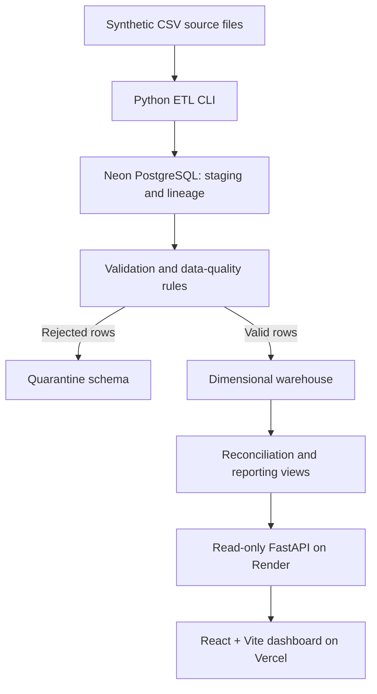

# BankFlow — Banking Transaction ETL & Analytics Warehouse

BankFlow is an end-to-end data engineering portfolio project that ingests synthetic banking events, validates data contracts, quarantines invalid records, loads a PostgreSQL dimensional warehouse, reconciles pipeline outcomes, and exposes read-only analytics through a FastAPI service and React dashboard.

[](https://bank-flow-eight.vercel.app/)
[](https://bankflow-reporting-api.onrender.com/api/v1/health)
[](https://github.com/GouravSharma26/BankFlow/actions/workflows/ci.yml)

> **Synthetic-data demo only.** BankFlow does not connect to real banks, handle real customer information, process real payments, or move money. Monetary values represent gross positive transaction-event amounts, not account balances, net cash flow, profit, or revenue.

## Live deployment

- **Dashboard:** https://bank-flow-eight.vercel.app/
- **API:** https://bankflow-reporting-api.onrender.com/
- **API health check:** https://bankflow-reporting-api.onrender.com/api/v1/health
- **Interactive API docs:** https://bankflow-reporting-api.onrender.com/docs

The deployed architecture uses **Vercel** for the React frontend, **Render** for the read-only API, and **Neon PostgreSQL** for the warehouse. The production deployment smoke-test run reported **13/13 checks passed on October 18, 2026**, including database health, analytics endpoints, CORS, read-only write protection, and frontend delivery.

## What it demonstrates

- **Batch ETL:** Generate and ingest reproducible CSV datasets, preserve raw source payloads, and track batches and row lineage.
- **Data contracts and quality:** Validate transaction and entity fields with stable rule codes, record issues, and quarantine rejected rows.
- **Dimensional warehousing:** Load conformed dimensions and transaction facts into a PostgreSQL star schema.
- **Idempotency and replay safety:** Prevent duplicate loading and distinguish identical replays from conflicting source events.
- **Reconciliation:** Compare pipeline counts and monetary values across stages, rejections, and warehouse facts.
- **SQL analytics:** Provide reusable reporting views for daily trends, deposit/withdrawal activity, branch/channel performance, transaction-type mix, data quality, batch health, and quarantine inventory.
- **Read-only API:** Serve reporting data through FastAPI using a dedicated least-privilege PostgreSQL reporting role.
- **Interactive dashboard:** Explore portfolio KPIs, transaction trends, quality issues, pipeline batches, and transaction facts with currency-aware filters.
- **Operational safeguards:** Use environment-based configuration, a dedicated test database, protected bootstrap target confirmation, TLS for hosted PostgreSQL, and automated CI and deployment smoke tests.

## Architecture



All monetary reports isolate currencies. BankFlow does not perform implicit FX conversion or combine different currencies into one total.

## Technology stack

| Layer | Technologies |
|---|---|
| Data engineering and CLI | Python 3.12+, Click |
| API | FastAPI, Uvicorn |
| Database and analytics | PostgreSQL, SQL, dimensional modeling |
| Data access and configuration | psycopg2, python-dotenv |
| Frontend | React 19, TypeScript, Vite, Tailwind CSS, Recharts |
| Testing | pytest, PostgreSQL integration tests, Vitest, TypeScript checks |
| Local development | Docker Compose |
| Hosting | Neon PostgreSQL, Render, Vercel |

## Run locally

### Prerequisites

- Python 3.12+
- Docker Desktop with Docker Compose
- Node.js and npm (for the dashboard)
- Git

### 1. Clone and install the Python project

```powershell
git clone https://github.com/GouravSharma26/BankFlow.git
cd BankFlow

py -3.12 -m venv .venv
.\.venv\Scripts\Activate.ps1
python -m pip install --upgrade pip
python -m pip install -e ".[dev,api]"
```

### 2. Start the local PostgreSQL databases

```powershell
if (-not (Test-Path .env)) { Copy-Item .env.example .env } else { Write-Host ".env already exists; leaving it unchanged." }
docker compose up -d --wait
python -m bankflow test-connection
python -m bankflow init-db
```

If you already have a configured `.env`, do not overwrite it. Docker Compose uses port `5432` by default; if that port is already occupied, set `BANKFLOW_DB_PORT=5433` in `.env`. The test database is initialized when Docker creates a new database volume.

### 3. Run a sample ETL batch

```powershell
python -m bankflow generate --output-dir data/samples --seed 42 --branches 5 --customers 25 --accounts 40 --transactions 100
python -m bankflow run --input-dir data/samples --batch-id demo-clean-001
python -m bankflow batch-status demo-clean-001
```

To exercise data-quality validation and quarantine, generate a dataset with defects:

```powershell
python -m bankflow generate --output-dir data/defective-sample --seed 42 --transactions 100 --with-defects
python -m bankflow run --input-dir data/defective-sample --batch-id demo-defects-001
python -m bankflow batch-status demo-defects-001
```

Run `python -m bankflow --help` for the full CLI.

### 4. Start the API

From the repository root, with the virtual environment activated:

```powershell
python -m bankflow serve --host 127.0.0.1 --port 8000
```

API docs are available at http://127.0.0.1:8000/docs.

### 5. Start the frontend

In a second terminal:

```powershell
cd frontend
if (-not (Test-Path .env.local)) { Copy-Item .env.example .env.local } else { Write-Host ".env.local already exists; leaving it unchanged." }
npm ci
npm run dev
```

Open http://localhost:5173. By default, the frontend's `VITE_BANKFLOW_API_BASE_URL` points to the local API at `http://localhost:8000`. Do not commit `.env.local`.

## CLI and reporting examples

```powershell
python -m bankflow report daily --limit 10
python -m bankflow report deposit-withdrawal
python -m bankflow report branch-channel
python -m bankflow report type-mix
python -m bankflow report quality
python -m bankflow report batches
python -m bankflow report quarantine
python -m bankflow report transactions --limit 5
```

Common CLI commands:

| Command | Purpose |
|---|---|
| `generate` | Create reproducible synthetic CSV files, optionally with defects |
| `stage` | Ingest a dataset directory |
| `validate BATCH_ID` | Run data-contract checks and quarantine rejected records |
| `load BATCH_ID` | Load accepted records into the dimensional warehouse |
| `reconcile BATCH_ID` | Check counts and monetary totals |
| `run` | Run staging, validation, loading, and reconciliation |
| `batch-status BATCH_ID` | Inspect a batch's current status and metrics |
| `report REPORT_NAME` | Query canonical analytics reports |
| `serve` | Start the read-only FastAPI reporting server |

## Tests and deployment verification

### Python and PostgreSQL

Start the local PostgreSQL service and ensure the dedicated `bankflow_test` database exists before running the full suite:

```powershell
python -m pytest tests -v
```

Destructive test setup is guarded so it cannot run against a database whose name is not recognized as a test database. CI is configured to require integration tests.

### Frontend

```powershell
cd frontend
npm ci
npm run lint
npm run test
npm run build
```

### Live deployment smoke test

From the repository root, test the deployed frontend and API:

```powershell
python scripts/smoke_test_deployment.py --api-url "https://bankflow-reporting-api.onrender.com" --frontend-url "https://bank-flow-eight.vercel.app" --timeout 90
```

The smoke test checks API metadata and health, reporting endpoints, CORS preflight, rejection of write requests, and frontend delivery. The latest reported production run passed all 13 checks.

## Deployment configuration

The repository includes `render.yaml`, `Dockerfile`, `Procfile`, `frontend/vercel.json`, and `netlify.toml`.

- **Database (Neon):** Hosted PostgreSQL; use TLS with `BANKFLOW_DB_SSLMODE=require`.
- **Backend (Render):** Uses the root `render.yaml` Blueprint. Configure `BANKFLOW_DB_HOST`, `BANKFLOW_DB_PORT`, `BANKFLOW_DB_NAME`, `BANKFLOW_DB_SSLMODE`, `BANKFLOW_REPORTING_DB_USER`, `BANKFLOW_REPORTING_DB_PASSWORD`, and `BANKFLOW_CORS_ORIGINS`.
- **Frontend (Vercel):** Set the project root to `frontend` and configure `VITE_BANKFLOW_API_BASE_URL=https://bankflow-reporting-api.onrender.com` and `VITE_DEMO_MODE=false`.

Use the [deployment guide](docs/deployment.md) for the complete provisioning sequence and environment-variable details. The remote bootstrap script requires explicit target confirmation and should only be run after verifying the intended host and database. **Never put administrator credentials or real secrets in the public API service or commit them to Git.**

## Repository structure

```text
BankFlow/
├── frontend/          # React + Vite analytics dashboard
├── src/bankflow/      # Python CLI, ETL, validation, warehouse, API
├── sql/               # Schema definitions, reporting views, role grants
├── tests/             # Unit, integration, API, analytics, deployment tests
├── scripts/           # Remote bootstrap and live deployment smoke tests
├── docker/            # Local PostgreSQL initialization
├── docs/              # Architecture, contracts, metric definitions, runbooks
├── render.yaml        # Render Blueprint
├── Dockerfile         # Container deployment
├── docker-compose.yml # Local PostgreSQL and test database
└── pyproject.toml     # Python package and CLI configuration
```

## Documentation

- [Deployment guide](docs/deployment.md)
- [Demo walkthrough and interview talking points](docs/demo_walkthrough.md)
- [Architecture](docs/architecture.md)
- [Dashboard API contract](docs/dashboard_api_contract.md)
- [Data contract](docs/data_contract.md)
- [Data dictionary](docs/data_dictionary.md)
- [Data-quality rules](docs/data_quality_rules.md)
- [Metric definitions](docs/metric_definitions.md)
- [Design decisions](docs/design_decisions.md)
- [Testing strategy](docs/testing_strategy.md)

## Safety and analytical limitations

- Use synthetic data only. No live banking integrations, payment execution, or real customer data are supported.
- Every monetary metric must be filtered or grouped by currency; there is no implicit FX conversion.
- Amounts are positive gross event values. They are not net cash flow, balances, bank revenue, or profit.
- The hosted API uses a dedicated read-only reporting role; pipeline writes belong to the controlled ETL/bootstrap process.
- Keep `.env`, `.env.local`, credentials, private connection strings, database dumps, and generated local datasets out of version control.
